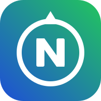
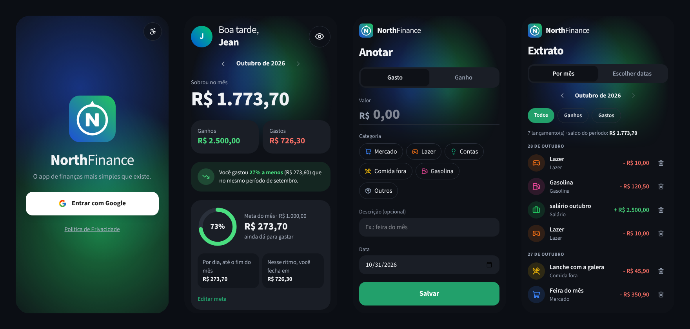

# NorthFinance

> O app de finanças mais simples que existe.

**🔗 [northfinance.vercel.app](https://northfinance.vercel.app)** · app instalável no celular (iPhone e Android) e no computador



## Por que eu criei

Eu usava um app de finanças com informação demais na tela, confuso e difícil de entender. O NorthFinance é a versão que eu queria usar: **anotar um gasto em segundos** e ver **para onde o dinheiro está indo**, sem bagunça. Hoje ele é usado por mim e pela minha família.

**Regra de ouro do produto:** pouca bagunça na tela, fácil de entender de primeira. Toda função nova precisa deixar o app mais simples, não mais bagunçado.

## O que ele faz

- **Início:** saldo do mês, ganhos e gastos, comparação com o mês anterior, gastos por dia e para onde foi o dinheiro por categoria.
- **Meta do mês:** quanto ainda dá para gastar, quanto isso dá por dia e a previsão de fechamento.
- **Anotar** um gasto ou ganho em poucos toques, com a opção de **repetir todo mês** (contas fixas são lançadas sozinhas).
- **Extrato** por mês ou por período, com filtro, e **edição** de qualquer lançamento.
- **Login com Google** e **convite por código**: cada pessoa vê só os próprios dados.
- **Esconder valores** com um toque (para abrir o app perto dos outros).
- **Acessibilidade:** tamanho do texto ajustável, alto contraste e compatível com leitor de tela.
- **Claro ou escuro**, seguindo o celular. No computador, o layout aproveita a tela larga.

## A história do projeto: de Python a app instalável

| | Versão 1 | Versão 2 (atual) |
|---|---|---|
| **Objetivo** | Validar a ideia rápido, com usuários reais | Virar um app de verdade, instalável |
| **Tecnologia** | Python + Streamlit | Next.js + TypeScript + Tailwind |
| **Hospedagem** | Streamlit Community Cloud | Vercel (servidor em São Paulo) |
| **Banco de dados** | PostgreSQL (Neon) | **O mesmo banco**: ninguém perdeu dados na troca |

A versão 1 provou que a ideia funcionava e trouxe os primeiros feedbacks (visual "de rascunho", selos da hospedagem, app que não parecia app). A versão 2 foi reconstruída para resolver exatamente isso.

## Segurança

- Login pelo Google (OpenID Connect): o app **nunca vê nem guarda senhas**.
- Toda consulta ao banco filtra pelo dono dos dados, inclusive editar e apagar.
- Consultas parametrizadas (proteção contra *SQL injection*).
- Limite de tentativas no código de convite.
- Cabeçalhos de segurança: *Content Security Policy*, proteção contra *clickjacking* e HTTPS obrigatório.
- Validação dos dados no servidor (valores e datas).
- Dependabot avisando sobre atualizações de segurança.
- Política de Privacidade alinhada à LGPD.

## Tecnologias

| Parte | Tecnologia |
|---|---|
| App (v2) | Next.js 16, React 19, TypeScript, Tailwind CSS, PWA |
| Login | Auth.js (Google) |
| Banco de dados | PostgreSQL no Neon, consultas em SQL |
| Hospedagem | Vercel |
| Versão 1 | Python, Streamlit, SQLAlchemy |

## Estrutura

```
web/          → versão 2 (Next.js), a que está no ar
web/sql/      → comandos SQL para preparar o banco
app.py        → versão 1 (Streamlit)
northfinance/ → código da versão 1
```

## Como rodar a versão 2

1. Crie um banco gratuito em <https://neon.com> e um cliente OAuth no Google Cloud.
2. Copie `web/.env.example` para `web/.env.local` e preencha.
3. Rode:
   ```bash
   cd web
   npm install
   npm run dev
   ```

## Lendo as sugestões dos usuários

As sugestões enviadas pelo Menu ficam na tabela `feedback`:

```sql
SELECT email, message, created_at
FROM feedback
ORDER BY created_at DESC;
```

---

Feito por **[Jean](https://github.com/Je4nms)**, no meu caminho para a área de dados e desenvolvimento.
