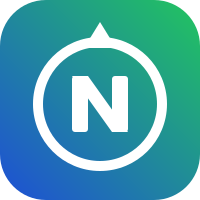

# NorthFinance

> O app de finanças mais simples que existe.

Eu usava um app de finanças com informação demais na tela, confuso e difícil de entender. O NorthFinance é a versão que eu queria usar: **anotar um gasto em segundos** e ver **para onde o dinheiro está indo**, sem bagunça.

🚧 **Em construção.** Versão atual: anotar ganhos e gastos, resumo do mês e extrato, com visual de app no celular (claro ou escuro, conforme o aparelho). Próximo passo: login com Google, para família e amigos usarem.

## Como usar no celular

Abra **<https://northfinance-je4nms.streamlit.app/?embed=true>** e adicione à tela inicial:
- **iPhone (Safari):** Compartilhar → Adicionar à Tela de Início.
- **Android (Chrome):** menu ⋮ → Adicionar à tela inicial.

O `?embed=true` no final esconde os selos do Streamlit Cloud, que ficariam por cima da barra de navegação.

## Regra de ouro

**Pouca informação na tela, fácil de entender de primeira.** Toda função nova precisa deixar o app mais simples, não mais bagunçado.

## O que ele faz

- **Anotar:** gasto ou ganho, com valor, categoria, descrição (opcional) e data.
- **Início:** quanto sobrou no mês, ganhos, gastos e para onde foi o dinheiro.
- **Extrato:** os lançamentos do mês separados por dia, com opção de apagar.
- **Barra de navegação embaixo**, como num app de celular.

## Tecnologias

| Tecnologia | Para quê |
|---|---|
| Python | Linguagem principal |
| Streamlit | Transforma o código Python em site, que funciona no celular |
| PostgreSQL (Neon) | Banco de dados online onde os gastos ficam salvos |
| SQLAlchemy + SQL | Conversa com o banco de dados |

## Como rodar

1. Crie um banco gratuito em <https://neon.com> e copie a **connection string**.
2. Copie o modelo das configurações e preencha:
   ```bash
   cp .streamlit/secrets.toml.example .streamlit/secrets.toml
   ```
3. Rode:
   ```bash
   streamlit run app.py
   ```
